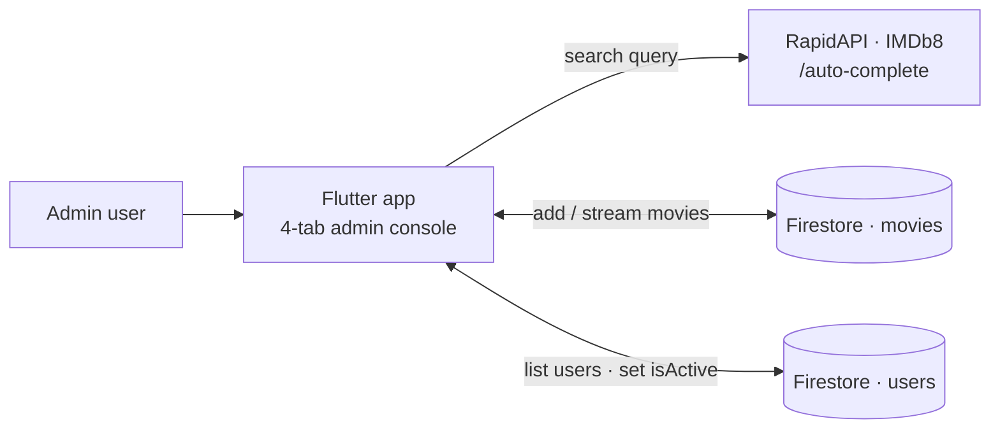

<div align="center">

# 🎬 Movie Admin — Flutter + Firebase Back-office App

**A Flutter admin app to search movies (IMDb8 via RapidAPI), curate a shared movie list in Cloud Firestore, and activate/deactivate users.**


</div>

---

## 📌 Overview

A dark-themed Flutter application (package `projet_mobile`) that opens directly on an **admin console** with four tabs:

| Tab | Screen | What it does |
|---|---|---|
| Home | `admin_home_page.dart` | Overview with shortcuts and a preview of the latest users (`users` collection) |
| Users | `users_list_page.dart` → `user_detail_page.dart` | Browse users; toggle a user's `isActive` flag in Firestore |
| Search | `search_movies_page.dart` | Query the IMDb8 `/auto-complete` endpoint and **add a movie** to the shared `movies` collection (duplicate check by movie id) |
| Watch list | `watch_list_page.dart` | Live stream of the saved movies from Firestore |

> **Scope.** This is a student prototype. The code does **not** implement end-user sign-in — `firebase_auth` is declared as a dependency but no authentication flow is used, and the movie list is one shared collection rather than per-user lists.

## 🧭 Architecture



## 🧰 Tech Stack

| Role | Tools |
|---|---|
| App | Flutter (Dart SDK ^3.9.2), Material |
| Backend-as-a-service | `firebase_core`, `cloud_firestore` (`firebase_auth` declared, not used) |
| Networking | `http` → RapidAPI IMDb8 |

## 🚀 Run

```bash
flutter pub get
flutterfire configure     # generate lib/firebase_options.dart for YOUR Firebase project
flutter run --dart-define=RAPIDAPI_KEY=<your RapidAPI key>
```

You need your own Firebase project (with `users` and `movies` collections) and a **RapidAPI key** subscribed to the IMDb8 API.

> 🔐 **API key.** The RapidAPI key is read at build time with `--dart-define=RAPIDAPI_KEY=...` and is never stored in the source. For a production app, call the API through your own backend instead of shipping a key in the client, restrict the Firebase API key, enable App Check and write Firestore security rules.

## ✅ Verification Status

The app was **not built or run** (Flutter SDK / Firebase project / RapidAPI key not available on the verification machine); the description is derived from the source code.

## 🖼️ Screenshots

<!-- TODO(user): add real screenshots of the four tabs. -->

## 🔭 Limitations & Future Work

- Add real authentication and role-based admin access (Firebase Auth + custom claims) and Firestore rules.
- Per-user watch lists, pagination, error states and offline caching.
- Only the default widget test exists — add widget and service tests.
- Move the third-party API call behind a backend so no secret ships in the client.

## 👤 Author

**Nour Ghribi** · [GitHub](https://github.com/Nour-Ghribi)
